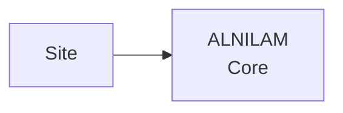

This guide demonstrates headings, links, code, a table, an image, and MDX.

## Structure starts with headings

Headings create a table of contents.

### Group related steps

Group steps under an H3.

#### Use H4 for a short aside

The default table of contents lists this article’s H2 and H3 headings. H4 headings still have anchors you can link to directly.

## Table

[Getting started](../getting-started/) uses a relative link that works at `/` and `/ALNILAM/`.

1. State the goal.
2. Verify the build.

> A useful example can be checked on the page.

Use HTTPS; add `rel="noopener noreferrer"` when opening a new tab: <a href="https://example.org/markdown" target="_blank" rel="noopener noreferrer">Safe external link</a>.

[Table anchor](#table) · [Email link](mailto:hello@example.org). Inline code keeps spaces: `a    b`.

Unsupported schemes lose their destination: [unsafe link](javascript:alert%281%29) · [unsafe reference link][unsafe-link].

[unsafe-link]: data:text/html,unsafe

Expressive Code highlights this YAML and adds a copy button:

```yaml
schemaVersion: 2
```

| Element | Example here |
| --- | --- |
| Headings | H2 through H4 |
| Code | Site v2 YAML |

The SVG `viewBox` is 640 × 360; its dimensions prevent layout shift. Alt text describes it:


See the [Site Onboarding image rules](https://github.com/Skyline-Gazer/ALNILAM/blob/dev/docs/SITE_ONBOARDING.md#images-policy).

MDX evaluates trusted expressions at build time; this only calculates `1 + 1`:

<p data-demo-mdx>MDX expression: {1 + 1}</p>

Edit trusted MDX source only. See [Astro configuration](https://github.com/Skyline-Gazer/ALNILAM/blob/dev/apps/web/astro.config.mjs). An inline variable is $r$; a display formula gets its own line:

$$
x = 1
$$

The browser renders this Mermaid diagram and keeps its source as a fallback:


