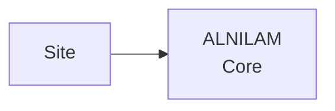

## 見出しから構成する

見出しから目次を作ります。

### 手順をまとめる

手順は H3 にまとめます。

#### 補足には H4 を使う

既定の目次にはこの記事の H2 と H3 が表示されます。H4 にも直接リンクできるアンカーが付きます。

## 表

[始め方のガイド](../getting-started/)を確認してください。相対リンクは `/` と `/ALNILAM/` の両方で使えます。

1. 目的を書く。
2. ビルドで確認する。

> よい例はページ上で確かめられます。

外部リンクは HTTPS にし、新しいタブには `rel="noopener noreferrer"` を付けます：<a href="https://example.org/markdown" target="_blank" rel="noopener noreferrer">安全な外部リンク</a>。

[表へ移動](#表)、[メールで連絡](mailto:hello@example.org)。`a    b` の空白も保たれます。

未対応の scheme はビルド時に削除されます：[安全でないリンク](javascript:alert%281%29) · [安全でない参照リンク][unsafe-link]。

[unsafe-link]: data:text/html,unsafe

Expressive Code は YAML をハイライトし、コピー用ボタンを表示します。

```yaml
schemaVersion: 2
```

| 要素 | この記事の例 |
| --- | --- |
| 見出し | H2 から H4 |
| コード | Site v2 YAML |

SVG の `viewBox` は 640 × 360。幅と高さで配置を安定させ、alt で内容を伝えます。


画像ルールは [Site Onboarding](https://github.com/Skyline-Gazer/ALNILAM/blob/dev/docs/SITE_ONBOARDING.md#images-policy)を参照してください。

MDX は信頼できる式をビルド時に評価します。ここでは `1 + 1` を計算します。

<p data-demo-mdx>MDX 式：{1 + 1}</p>

信頼できる MDX だけ編集してください。[Astro 設定](https://github.com/Skyline-Gazer/ALNILAM/blob/dev/apps/web/astro.config.mjs)。行内の変数は $r$、ブロック数式は独立した行に表示されます。

$$
x = 1
$$

Mermaid はブラウザーで描画され、ソースも残ります。


