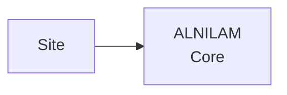

本文示范标题、链接、代码、表格、图片和 MDX。

## 结构从标题开始

标题会生成目录。

### 把相关步骤放在一起

步骤可放在 H3 下。

#### 用 H4 为一小段补充说明

默认目录列出本文的 H2 和 H3。H4 仍有可直接链接的锚点。

## 表格

[开始使用指南](../getting-started/) 使用相对链接，可在根路径和 `/ALNILAM/` 打开。

1. 写清目标。
2. 构建后验证。

> 好的示例可以在页面上验证。

外链用 HTTPS；新标签链接加上 `rel="noopener noreferrer"`：<a href="https://example.org/markdown" target="_blank" rel="noopener noreferrer">安全外链</a>。

[站内锚点](#表格) · [邮件链接](mailto:hello@example.org)。`a    b` 中的连续空格会保留。

不支持的协议会移除目标地址：[不安全链接](javascript:alert%281%29) · [不安全引用链接][unsafe-link]。

[unsafe-link]: data:text/html,unsafe

Expressive Code 为代码高亮并提供复制按钮：

```yaml
schemaVersion: 2
```

| 元素 | 本文示例 |
| --- | --- |
| 标题 | H2 到 H4 |
| 代码 | Site v2 YAML |

SVG 的 `viewBox` 是 640 × 360；构建会写入宽高，避免布局跳动。alt 描述画面：


图片规则见 [Site Onboarding](https://github.com/Skyline-Gazer/ALNILAM/blob/dev/docs/SITE_ONBOARDING.md#images-policy)。

MDX 会在构建时执行可信表达式；这里只计算 `1 + 1`：

<p data-demo-mdx>MDX 表达式：{1 + 1}</p>

只编辑可信的 MDX 源码。见 [Astro 配置](https://github.com/Skyline-Gazer/ALNILAM/blob/dev/apps/web/astro.config.mjs)。行内变量是 $r$；块级公式单独展示：

$$
x = 1
$$

Mermaid 在浏览器绘图，并保留可读源文本：


